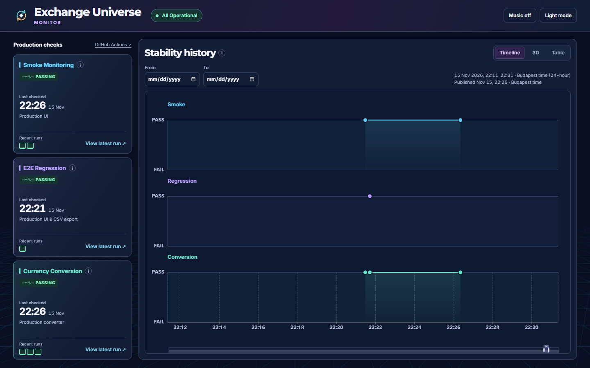

# Exchange Universe Monitor

Synthetic browser monitoring for the [Exchange Universe currency atlas](https://sadeq.shinyapps.io/exchange_universe/). A Playwright runner checks public user journeys, and a local dashboard makes failures, timing and evidence easy to inspect. Optional SMTP alerts reach the configured recipients even when the dashboard tab is closed.

[Live monitoring dashboard](https://rammeshgar.github.io/exchange-universe-monitor/) · [GitHub Actions](https://github.com/Rammeshgar/exchange-universe-monitor/actions) · [Windows download](https://github.com/Rammeshgar/exchange-universe-monitor/releases/latest) · [Case study](https://rammeshgar.github.io/exchange-universe/#monitoring)

*Dashboard preview with illustrative runs. The public dashboard shows recorded GitHub Actions results.*

## Hosted monitoring

GitHub Actions runs Smoke every 15 minutes and Regression hourly. The public dashboard refreshes once a minute and offers the latest 200 runs, check details, failure screenshots when available, downloads, and links to the matching Actions runs. GitHub schedules can start late.

Run either suite from **Actions → Exchange Universe monitoring → Run workflow**. The workflow saves recent results on the `monitor-data` branch and deploys the dashboard to GitHub Pages, including when a check fails. The browser uses the live app's public test paths.

For hosted alerts, set the `MAIL_SERVER_ADDRESS`, `MAIL_SERVER_PORT`, `MAIL_USERNAME`, `MAIL_PASSWORD`, `MAIL_SENDER_ADDRESS`, and `MAIL_RECIPIENT_ADDRESS` repository Actions secrets. The SMTP step handles failure, reminder, and recovery independently for each suite. Optional Actions variables `ALERT_TIMEZONE`, `ALERT_START_HOUR`, and `ALERT_END_HOUR` control the failure notification window.

## Install and start locally

1. Download **Exchange-Universe-Monitor-Windows.zip** from Releases and extract it to a folder you can write to.
2. Install Node.js 22 or later if needed.
3. Double-click **Setup Monitor.cmd** once to install the locked dependencies and Playwright's Chromium browser. For an existing installation, run setup again after replacing the source with this version. The monitor serves its charts and fonts locally.
4. Double-click **Start Dashboard.cmd** and open `http://127.0.0.1:4914/` if the browser does not open automatically.

The launcher starts a background process for the current Windows session. The browser tab can close while checks continue. If you want to stop the process from its terminal, start it in a visible terminal with `npm start` instead of using the launcher, then press Ctrl+C. **Pause schedule** suspends future scheduled runs in either mode. Start the monitor again after signing in or rebooting.

## Check suites

| Suite | Schedule | Live checks |
| --- | --- | --- |
| Smoke | Every 15 minutes | HTTP and Shiny readiness, currency history with numeric data, and EUR-to-HUF conversion |
| Regression | Every hour | All Smoke checks, the interactive currency atlas and its fullscreen control, the comparison table, and a real CSV export |

Open **Run controls** below the status cards, choose a suite, and select **Run check** to start immediately. Runs never overlap. The scheduler needs an awake PC and a running monitor process. After sleep, each overdue suite runs once before returning to its normal interval. The Currency Conversion card and chart lane show the converter outcome from each completed suite. The timeline uses 24-hour Budapest time, and each run export includes the UTC timestamp. **Music Off** starts the Exchange Universe soundtrack on demand.

The runner uses the normal app controls and skips the manual **Refresh rates** button. An ordinary visit can still cause the app to use its cache or provider. The converter check verifies that doubling the input doubles the displayed result within rounding tolerance. It does not validate the quoted rate against an independent source.

## Email alarms

The background monitor follows the [FRAIA v2 alert workflow](https://github.com/FRAIA-AI/Test_Automation_v2#alert-behavior). Each suite emails its first failure from 04:00 through 17:00 UTC, excluding 17:00. A failure after a 60-minute cooldown triggers a reminder. The first successful run after a failure email sends a recovery email, including outside the failure window. Failure and reminder emails include the failed check and attach a screenshot and result JSON when available and within the size limit.

1. Copy `email-alerts.env.example` to `email-alerts.env` next to `dashboard.cjs`.
2. Enter your SMTP host, port, username, password or SMTP key, verified sender, and one or more comma-separated recipient addresses. The monitor reads those settings after each run.
3. From the same folder, run `npm run test-email` to send a clearly labeled test message to the configured recipients. The command reports SMTP acceptance. Check the recipient inbox to verify delivery.

Mail settings are local to this installation. Use port 465 for implicit TLS or your provider's STARTTLS port. Leave the settings file absent to run without email. Delivery outcomes go to the monitor process output.

## Run evidence

Select a dot in the matrix or **View run** in the table to see its checks and evidence. The chart and table start with the past 24 hours. Use the date inputs for older results. The 2D timeline includes a zoom slider, and the 3D chart supports mouse orbit, pan, and zoom. **Data Table** works on browsers without WebGL and exports the visible date range as CSV, JSON, or text. Reports, screenshots, and downloaded comparison CSVs are stored under `runs/`. The dashboard displays up to 300 recent results. The archive starts with an empty history.

For a one-off terminal check, run `npm run check -- smoke` or `npm run check -- regression`. The process returns exit code 1 on failure. To use the scheduler, alarm delivery, and failure/recovery tracking, start checks from the dashboard.

The interface adapts the [original PC-test-automation dashboard](https://github.com/Rammeshgar/PC-test-automation/blob/main/dashboard/index.html). The public package includes a generated ambient loop for its optional music control.
